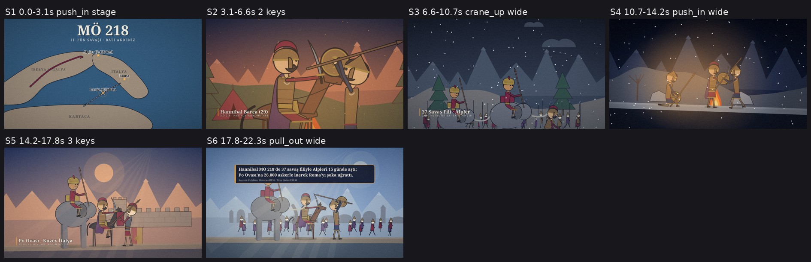
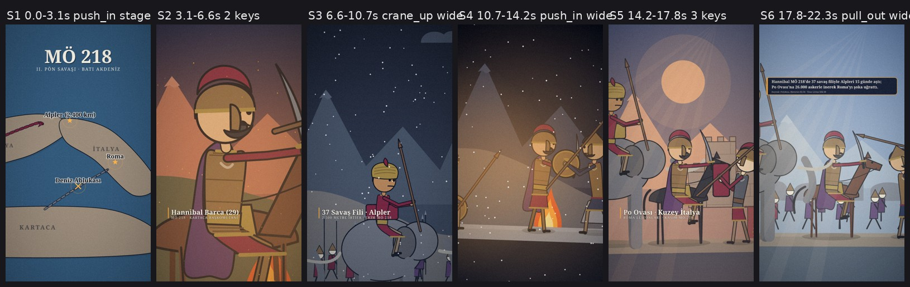
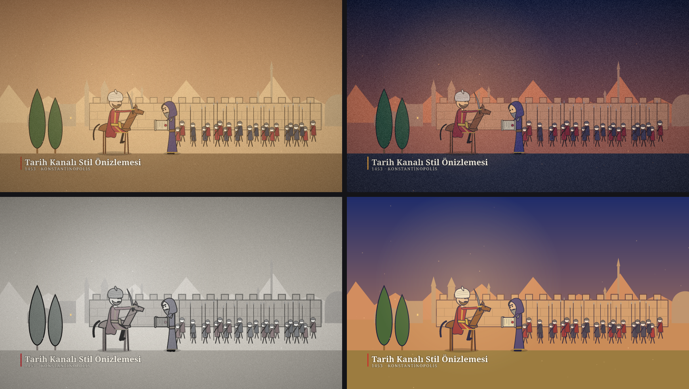

# Stick History (`stick-history`)

Gerçek tarih olaylarını ve dışarıdan eklenen bir seslendirme dosyasını (herhangi bir dilde), dönemine uygun karakter ve mekanlarla, dinamik kamera hareketleriyle **hem yatay (16:9) hem dikey (9:16)** stick-figure animasyon bölümüne dönüştüren, **agent'tan bağımsız** açık kaynaklı skill.





- **Remotion / Node yok:** Saf Python (`resvg-py` + `numpy` + `Pillow` + `ffmpeg`).
- **ElevenLabs / ücretli API yok:** Seslendirme dosyası `episodes/<slug>/voice/` klasörüne bırakılır; ses efektleri (40+ prosedürel SFX) ve makam/mod tabanlı müzik yatağı kodla sentezlenir.
- **Dönem kısıtı yok:** Hazır dönem kalıplarına sıkışmaz; her olay için dönemin kıyafetlerini, başlıklarını, silahlarını, bineklerini, gemilerini ve mimarisini araştırıp parametrik parçalarla (veya özel `svg` parçalarıyla) kurar.
- **Her kanal özgün:** İlk kullanımda 7 soruluk **stil anketi** (`palette`, `line`, `face`, `texture`, `camera`, `font`, `ending` + *Bana sürpriz yap*) ile kanala özel `profile.json` oluşturur; her bölümden sonra geri bildirimleri `learned.md` ve `history.json` içine kaydederek öğrenir.
- **Her agent'ta çalışır:** Açık `SKILL.md` standardını izler (Antigravity, Claude Code, OpenCode, Cursor, Gemini CLI, Codex vb.). Agent yüzlerce satır kod yerine küçük bir `scenes.json` DSL dosyası yazar.



---

## Kurulum

Python 3.10+ gerektirir:

```bash
pip install -r requirements.txt
# İsteğe bağlı (script.txt verilmediğinde sesi otomatik transkribe etmek için önerilir):
pip install faster-whisper
```

---

## Hızlı Başlangıç (CLI)

Çalışma klasörünüzde projeyi başlatın:

```bash
python /path/to/stick-history/run.py init
```

1. **Stil profilini seçin (ilk kullanımda bir kez):**
   ```bash
   python /path/to/stick-history/run.py quiz
   python /path/to/stick-history/run.py style --set palette=midnight line=clean face=expressive texture=paper camera=dynamic font=serif ending=fact --preview
   ```

2. **Yeni bölüm oluşturun ve seslendirmenizi ekleyin:**
   ```bash
   python /path/to/stick-history/run.py new hannibal-alps --topic "MÖ 218 — Hannibal'ın 37 Savaş Filiyle Alpleri Geçişi"
   # Ses dosyanızı episodes/hannibal-alps/voice/ içine koyun (wav, mp3, m4a, ogg, flac)
   python /path/to/stick-history/run.py align hannibal-alps --words
   ```

3. **Sahne planını (`scenes.json`) denetleyin ve storyboard üretin:**
   ```bash
   python /path/to/stick-history/run.py check hannibal-alps
   python /path/to/stick-history/run.py board hannibal-alps
   python /path/to/stick-history/run.py grid hannibal-alps S2 S3 S5
   ```

4. **Sesleri sentezleyin ve her iki formatta (`16:9` + `9:16`) -14 LUFS master alın:**
   ```bash
   python /path/to/stick-history/run.py sound hannibal-alps
   python /path/to/stick-history/run.py master hannibal-alps --quality final
   ```

5. **Bölüm sonunda geri bildirimleri kaydedin (skill bir sonraki bölümde hatırlar):**
   ```bash
   python /path/to/stick-history/run.py learn hannibal-alps --like "Harita geçişi ve fırtına atmosferi" --rule "Gece sahnelerinde meşale ışığı kullan"
   ```

---

## Klasör Yapısı

| Yol | Açıklama |
|---|---|
| `SKILL.md` | Agent'ların izlediği ana üretim boru hattı ve kurallar |
| `run.py` | Tek giriş noktalı CLI (`init`, `quiz`, `style`, `new`, `align`, `check`, `board`, `grid`, `render`, `sound`, `master`, `learn`, `catalog`) |
| `stickhistory/` | Python motoru: SVG sahne grafiği, parametrik karakter rig'i, binekler, mimari/doğa/harita/belge ilkelleri, kamera ve geçişler, prosedürel ses/müzik sentezi, otomatik denetleyici |
| `references/` | Stil anketi, dönem araştırma rehberi, DSL referansı, kamera yönetimi, ses/miks ve tuzaklar (`traps.md`) |
| `examples/` | `style-sample` (stil önizleme sahnesi), `hannibal-alps` (MÖ 218 Alpler geçişi) ve `1453-halic` (1453 Haliç kuşatması) |

## Lisans

[MIT](LICENSE)
